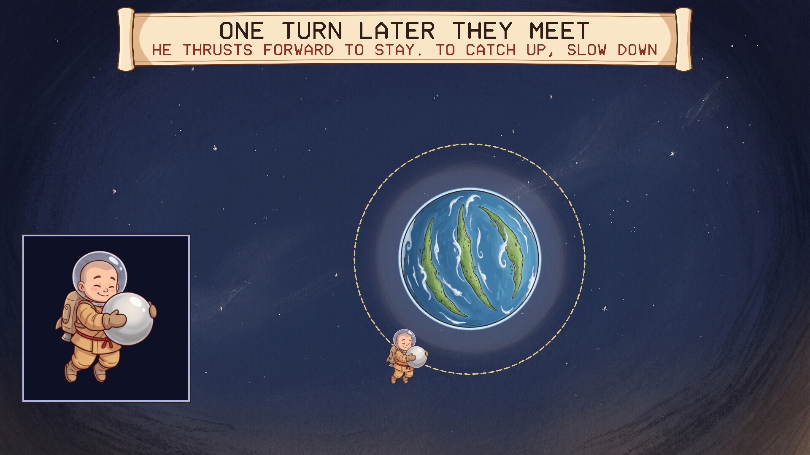
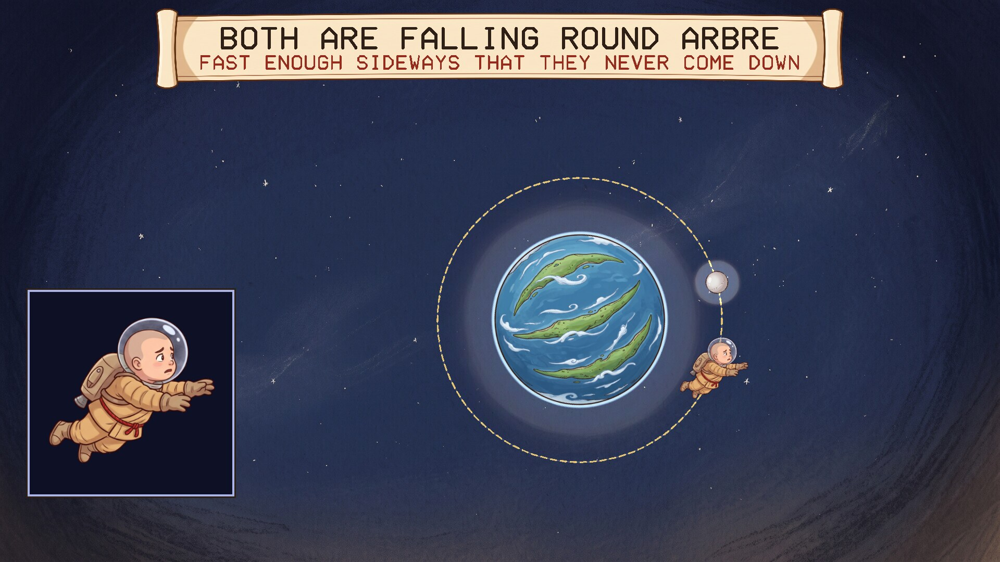
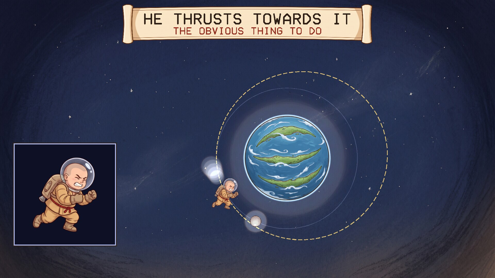
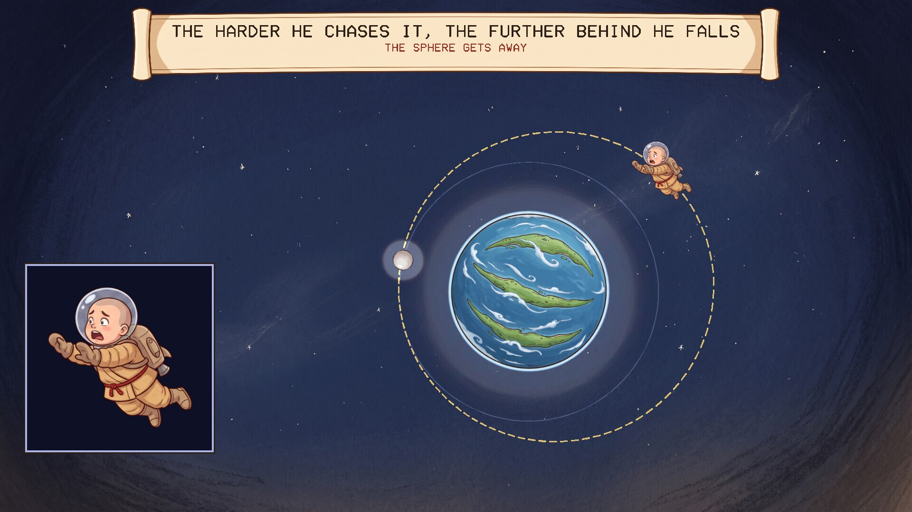
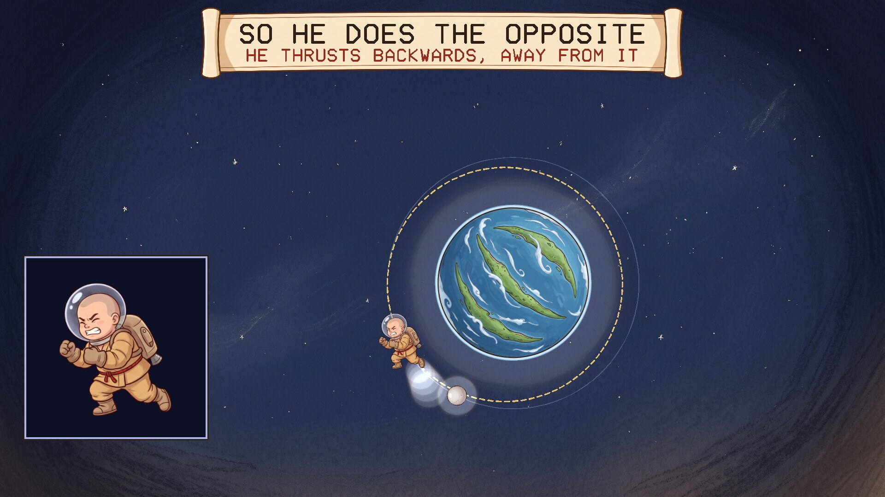

# A Fraa in Orbit

A screensaver of orbital mechanics, after Neal Stephenson's novel *Anathem*. Runs on
Linux and Windows. One of the [Anathem screensavers](https://github.com/mottipython/anathem-screensavers).

## The idea

In orbit, steering by common sense does not work. Something ahead of you on your
own orbit cannot be reached by thrusting towards it: the extra speed lifts you into
a higher orbit, a higher orbit takes longer to go round, and the thing you were
chasing draws away. To catch it you thrust the other way. That drops you into a
lower orbit, which is a quicker one, and you gain. The saying is: forward is up, up
is back, back is down, down is forward.

## What the screensaver shows

A small fraa in a home-made spacesuit, in orbit about Arbre, who has let go of his
sphere. It is a little way ahead of him on the same orbit. About a minute:

| | |
|---|---|
|  |  |
| He and his sphere, falling round Arbre | He thrusts towards it, the obvious thing |
|  |  |
| Higher is slower: it gets away | So he thrusts backwards instead |

One turn later the lower orbit brings him back to where he started just as the
sphere arrives there. He thrusts forward to stay, and has it.

## The science

Nothing is animated by hand. Arbre pulls on him by the inverse square of his
distance, and his path is worked out from that pull in small steps. The gold dotted
line is the orbit that his position and speed at that instant put him on, so it
changes the moment he thrusts.

The catching orbit is worked out, not guessed. The sphere is 35 degrees ahead, so
he needs an orbit whose turn is shorter than the sphere's by 35/360 of a turn; by
Kepler's third law that fixes its size, and its size fixes the speed he must slow
to. After exactly one turn of it he is back at the same point and the sphere is
there. The rise in the first attempt is a thrust of 8.5 per cent of his speed.

Left out: Arbre's size and mass are not given, so the distances are in Arbre-radii
and the turn is set to twelve seconds; the thrusts are instant; and real
spacefarers would do this more gently, over several turns.

### What is from the book and what is mine

The book has avout sent into orbit who must learn that their intuitions about
moving are wrong there. The rule itself is ordinary orbital mechanics.

The fraa, his suit, losing his sphere, and this particular chase are mine.

## Install

Packages are on the [releases page](../../releases).

### Windows

Run `FraaInOrbit-Setup-1.0.0.exe`. It asks for administrator rights, because Windows
only lists screensavers that are in its own system folder. After that "A Fraa in Orbit" is in Screen Saver Settings with the others, already selected. Uninstall from
Apps.

### macOS

There are two downloads on the releases page, for Apple Silicon and Intel, macOS 11
or later.

**The screen saver** is the file ending `-mac-screensaver.zip`. Unzip it and
double-click the `.saver` file; macOS offers to install it. Then choose it in System
Settings, Screen Saver (scroll to the end of the list, under Other).

**The app** is the file ending `-mac.zip`: the same thing as an ordinary program
that runs full screen until you press a key.

Neither is signed with an Apple developer certificate, so macOS will refuse them at
first. After the refusal, open System Settings, Privacy & Security, scroll down,
and click Open Anyway. If the screen saver still will not load, clear the
quarantine mark in Terminal:

    xattr -dr com.apple.quarantine ~/Library/"Screen Savers"

Both are built on a Mac build machine, where the screen saver is loaded and made to
draw as a test. They have not yet been tried by a person on a real Mac, and screen
savers on recent macOS are known to be temperamental; reports are welcome.

### Linux

**Fedora, Nobara** (built on Fedora 44):

    sudo dnf install ./fraa-in-orbit-1.0.0-1.fc44.x86_64.rpm

**Debian, Ubuntu, Mint** (Ubuntu 24.04 / Debian 13 or later):

    sudo apt install ./fraa-in-orbit_1.0.0_amd64.deb

From your next login it starts by itself after five minutes idle, and any key or
mouse movement ends it. To start the watcher without logging out, or to change the
delay:

    fraa-in-orbit-screensaver enable 10    # after 10 minutes idle
    fraa-in-orbit-screensaver disable
    fraa-in-orbit-screensaver status
    fraa-in-orbit-screensaver now          # run it right away

Wayland desktops have no screensaver service to plug into, so the package starts a
small idle watcher (`swayidle`) at login. It works on compositors that provide the
ext-idle-notify protocol: KDE Plasma, Sway, Hyprland, niri, COSMIC, labwc and
others. GNOME does not provide it, and on X11 you would add `fraa-in-orbit` to
xscreensaver or your desktop's own idle settings. It does not lock the screen. If
one of the other *Anathem* screensavers
([Teglon](https://github.com/mottipython/teglon),
[the Lazy Peregrin](https://github.com/mottipython/lazy-peregrin),
[Cutting the Cake](https://github.com/mottipython/cutting-the-cake),
[the Clock of Saunt Edhar](https://github.com/mottipython/edhar-clock),
[the Weed War](https://github.com/mottipython/weed-war),
[the Daban Urnud](https://github.com/mottipython/daban-urnud),
[the Adrakhonic Theorem](https://github.com/mottipython/adrakhonic),
[the Analemma](https://github.com/mottipython/analemma),
[Bolt, Chord and Sphere](https://github.com/mottipython/bolt-chord-sphere),
[the Wick](https://github.com/mottipython/wick)) is already on screen it stays out of the way.

If [screensaver-service](https://github.com/mottipython/screensaver-service) is
installed, A Fraa in Orbit appears in its list of screen savers, and that service starts
it in place of the watcher described above.

## Running it yourself

    fraa-in-orbit              full screen on every display; any key or mouse movement quits
    fraa-in-orbit --window     in a window; Esc or Q quits
    fraa-in-orbit --speed 2    faster
    fraa-in-orbit --snapshot out.bmp --time 60 --size 1920x1080

## Building

Needs a C compiler, make and SDL2 (2.0.18 or newer). Build from the top of the
source tree, because the pictures in `assets/art` are built into the program.

    make
    make check
    sudo make install

Packages are written to `dist/`. `tools/Containerfile` describes a container with
everything they need:

    podman build -t anathem-build -f tools/Containerfile tools
    podman run --rm --security-opt label=disable -v "$PWD":/src -w /src anathem-build make dist

## Credits and licence

MIT. *Anathem* is Neal Stephenson's; this is an unofficial fan project.

The pictures (the fraa, Arbre, the sphere, the sky and the scroll) were drawn with
Google Gemini and prepared by `tools/make_sprites.py`. Images are decoded with
[stb_image](https://github.com/nothings/stb) (public domain).
